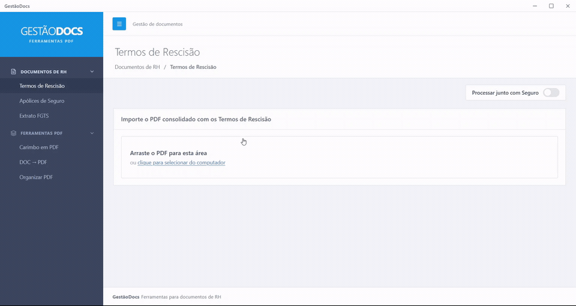

# GestãoDocs

Aplicativo desktop para separar, organizar e preparar documentos de RH, com processamento local e interface em React.



## Por que criei este projeto

Durante minha experiência como assistente administrativo na Icomon, passei um período no RH e identifiquei a necessidade de facilitar a separação e a organização de documentos. Como os computadores tinham acesso limitado à internet, a solução precisava funcionar localmente.

O GestãoDocs nasceu desse contexto: reunir tarefas repetitivas de documentos em uma interface desktop, sem depender de um servidor para processar os arquivos.

## Funcionalidades

| Ferramenta | O que faz |
| --- | --- |
| TRCT | Identifica o início de cada termo de rescisão e agrupa as páginas por funcionário. |
| Seguro | Separa pares de páginas de um PDF consolidado no formato esperado pelo módulo. |
| TRCT + Seguro | Combina os documentos pelo nome do funcionário e exporta pastas em um ZIP. |
| FGTS | Lê extratos analíticos em TXT e gera PDFs individuais. |
| Carimbo | Aplica uma imagem de carimbo em PDFs. |
| Organizar PDF | Reúne páginas de diferentes PDFs, reordena, gira, remove e exporta. |
| DOC/DOCX → PDF | Converte documentos usando o Microsoft Word instalado no Windows. |

Quando uma página não tem texto suficiente para leitura direta, o app recorre ao OCR do Windows para reconhecer o texto da imagem. Os documentos são processados no computador; a aplicação não faz upload dos arquivos.

## Como funciona

A interface e as regras de processamento são implementadas em React/JavaScript. O Tauri integra a aplicação ao desktop, e o código Rust concentra o acesso ao OCR do Windows. A conversão pelo Word usa um script PowerShell separado.

```text
Interface React
  → seleção de arquivos pelos plugins do Tauri
  → extração de texto com PDF.js
  → OCR do Windows via Rust, quando necessário
  → identificação e agrupamento em JavaScript
  → geração de PDFs e ZIPs no próprio computador
```

- **React, Vite e Tailwind CSS:** interface e build do frontend.
- **PDF.js:** leitura de texto e prévias das páginas.
- **pdf-lib e jsPDF:** edição de PDFs e geração dos extratos.
- **fflate e dnd-kit:** arquivos ZIP e ordenação por arrastar e soltar.
- **Tauri 2:** janela desktop, diálogos, acesso a arquivos e comunicação com o sistema.

## Executar em desenvolvimento

O ambiente de referência é **Windows**. OCR e conversão pelo Word dependem dele.

Pré-requisitos:

- Node.js **22.13 ou superior** e npm, conforme a exigência da versão de PDF.js usada no projeto.
- Rust estável com a toolchain MSVC.
- Microsoft C++ Build Tools, Windows SDK e WebView2, conforme os [pré-requisitos oficiais do Tauri](https://v2.tauri.app/start/prerequisites/).
- Recurso de OCR do Windows instalado em um idioma compatível. O app tenta português do Brasil e depois os idiomas do perfil do usuário.
- Microsoft Word instalado, somente para a ferramenta DOC/DOCX → PDF.

Na pasta do projeto:

```bash
npm ci
npm run dev
```

A instalação inicial das dependências precisa de internet. O processamento dos documentos é local depois de preparar o ambiente. Para utilizar o aplicativo compilado, não é necessário instalar Node.js ou Rust; as dependências do Windows das ferramentas continuam necessárias.

## Comandos

| Comando | Finalidade |
| --- | --- |
| `npm run dev` | Abre o app desktop em desenvolvimento. |
| `npm run dev:vite` | Abre somente o frontend; as operações nativas exigem Tauri. |
| `npm run build` | Compila o app e gera os instaladores em `src-tauri/target/release/bundle/`. |
| `npm run build:vite` | Compila apenas o frontend. |
| `npm test` | Testa as regras de documentos e a geração de PDF/ZIP com dados fictícios. |
| `cargo check --manifest-path src-tauri/Cargo.toml` | Verifica a compilação do Rust e a configuração nativa. |

O teste de integração do OCR é opcional e exige Windows com o recurso de idioma instalado:

```bash
cargo test --manifest-path src-tauri/Cargo.toml --lib -- --ignored
```

## Estrutura

```text
src/components/          Telas e componentes React
src/lib/                 Regras de documentos, PDFs, ZIPs e integração com Tauri
src-tauri/src/           Inicialização do app e OCR em Rust
src-tauri/scripts/       Conversão pelo Word via PowerShell
src-tauri/capabilities/  Permissões dos plugins nativos
tests/                   Testes e PDF fictício para validar o OCR
```

## Limitações conhecidas

- As regras de TRCT, seguro e FGTS foram feitas para formatos específicos. Outros layouts podem exigir ajustes; revise os arquivos gerados antes de utilizá-los.
- O seguro espera um número par de páginas: primeiras páginas na primeira metade e segundas páginas na segunda metade, na mesma ordem.
- A combinação de TRCT e seguro usa nomes, não um identificador único. Homônimos e diferenças no texto reconhecido podem causar associações incorretas.
- O OCR depende da qualidade do documento e dos idiomas instalados. As páginas são processadas uma por vez em segundo plano; lotes grandes podem demorar.
- O TXT de FGTS é lido como UTF-8. Arquivos com outra codificação podem apresentar caracteres incorretos.
- A economia de tempo mostrada na interface é uma estimativa com referência de 1,3 minuto por documento, não uma medição de produtividade em ambiente real.

## Licença

[MIT](LICENSE).
